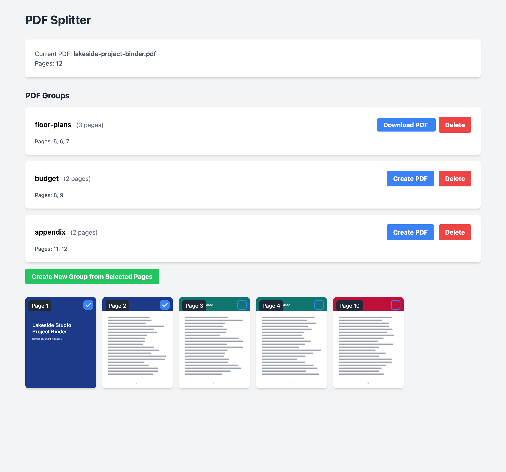

<div align="center">

<h1>PDF Tools</h1>

<p><b>Split one PDF into several, by picking pages.</b></p>

<p><i>Pulling three chapters out of a long scan usually means a paid editor or a page-range dialog you can't see. This shows every page and lets you click.</i></p>

<h6>


</h6>

<a href="#how-it-works"><b>How it works</b></a> ·
<a href="#run-it"><b>Run it</b></a> ·
<a href="#limits"><b>Limits</b></a>

<br><br>



<sub>A made-up 12-page PDF, split into three groups. Captured from a local run.</sub>

</div>

<br>

## How it works

<table>
<tr>
<td width="33%" valign="top">

**1 · Drop in a PDF**

Put a PDF in `input/` and start the server. Every page is rendered to a thumbnail with
Poppler (`pdf2image`).

</td>
<td width="33%" valign="top">

**2 · Group pages**

Tick pages, press *Create New Group*, and name it. Grouped pages leave the grid, so each page
ends up in exactly one group.

</td>
<td width="33%" valign="top">

**3 · Build and download**

*Create PDF* writes that group's pages, in order, to `output/<name>.pdf` with PyPDF2, then the
button turns into *Download PDF*.

</td>
</tr>
</table>

Everything runs on your machine: a FastAPI server with three endpoints (`/pdf/info`,
`/pdf/split`, `/thumbnails/{page}`) and one HTML page styled with Tailwind. Nothing is uploaded
anywhere.

## Run it

Needs Python 3.8+ and Poppler (`brew install poppler` on macOS, `sudo apt-get install
poppler-utils` on Ubuntu).

```bash
git clone https://github.com/parthchandak02/pdf-tools.git
cd pdf-tools
python -m venv venv && source venv/bin/activate
pip install -r requirements.txt
cp ~/Downloads/some-file.pdf input/
uvicorn main:app --reload        # then open http://localhost:8000
```

## Limits

- **One PDF at a time.** The server uses the first `.pdf` it finds in `input/`.
- **Up to 100 pages.** Larger files are refused.
- **Thumbnails are cached per file.** They are re-rendered whenever the PDF in `input/` is
  replaced or edited (name, size or modification time changes).
- **Output names are sanitised.** Group names become plain file names inside `output/`; any
  folder part such as `../` is dropped.
- **A single-day project** from December 2024, built for one job and not developed since.

<details>
<summary><b>Project layout</b></summary>

```
main.py               FastAPI app: page count, thumbnail rendering, splitting
templates/index.html  The whole UI: thumbnail grid, page groups, create and download
input/                Put the source PDF here
output/               Built PDFs land here (served at /output)
static/thumbnails/    Rendered page images, created on first load
```

</details>

<br>

<div align="center">
<sub>Built with FastAPI, pdf2image, PyPDF2 and Tailwind CSS.</sub>
</div>
